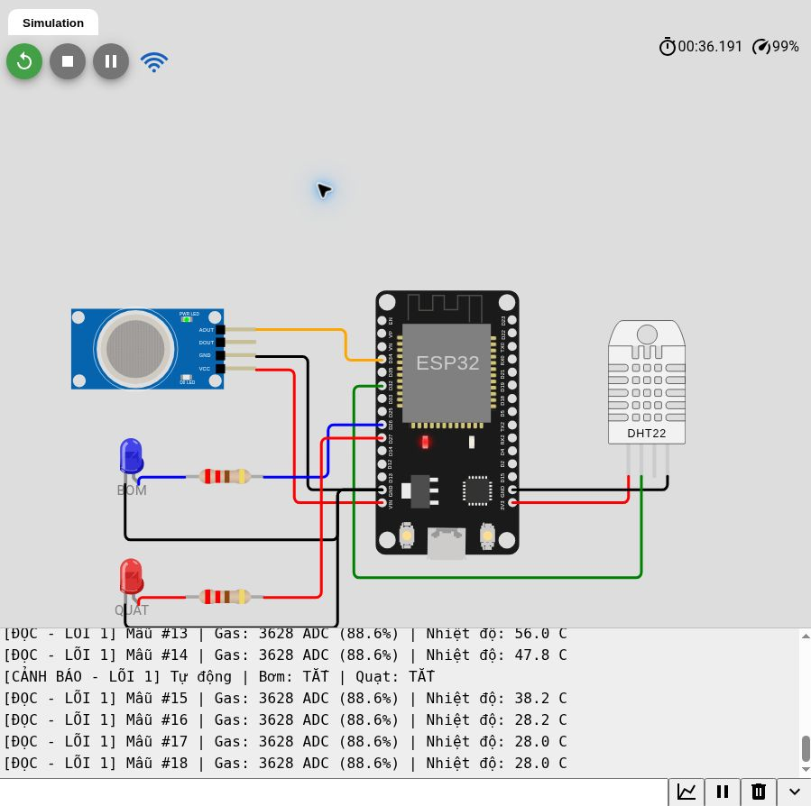
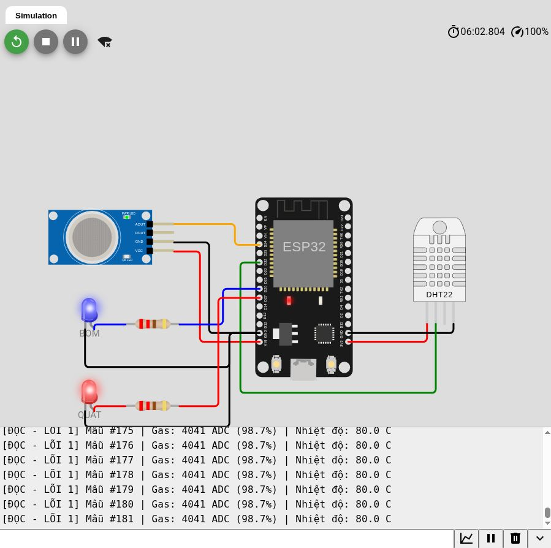

# LAB 3 ĐỀ 3 · HỆ THỐNG BÁO CHÁY GIA ĐÌNH

[BÁO CÁO THỰC HÀNH](Report/Bao_cao_Lab3_De3_TNH.docx)

**Sinh viên Thực hiện** Trần Nguyên Huân · **Mã sinh viên** 231432247

**Nền tảng** ESP32 DevKit V1 · MQ-2 · DHT22 · FreeRTOS · MQTT · Web Dashboard  
**Mô phỏng** [Tạo dự án ESP32 trên Wokwi](https://wokwi.com/projects/new/esp32) · [Tệp mạch và chương trình](Wokwi)

## 1. Giới thiệu

ESP32 đọc mức gas/khói từ MQ-2 và nhiệt độ từ DHT22, hiển thị trên Serial và gửi MQTT. Hai LED đại diện cho quạt và bơm trong Wokwi. Dashboard có hai thẻ số liệu, hai biểu đồ thời gian thực và hai nút điều khiển khi chọn MANUAL.

RTOS cho phép lập lịch theo độ ưu tiên và cho task ngủ khi chờ dữ liệu. FreeRTOS có queue và semaphore, hỗ trợ chạy task trên hai lõi của ESP32. Chi phí chính là stack riêng cho mỗi task và việc phải chọn ưu tiên, kích thước queue và thời hạn chờ phù hợp. Semaphore báo sự kiện hoặc theo dõi số tài nguyên rảnh. Queue truyền bản ghi đầy đủ giữa các task, phù hợp để gửi cùng lúc gas, nhiệt độ và cờ hợp lệ.

## 2. Chức năng và kiến trúc

| Task | Lõi | Ưu tiên | Stack | Công việc |
|---|---:|---:|---:|---|
| Transmit | 0 | 1 | 6.144 B | Kết nối Wi-Fi, lấy mẫu từ `dataQueue`, gửi MQTT và nhận lệnh web |
| Read | 1 | 2 | 4.096 B | Đọc cảm biến mỗi 2 giây, in Serial, gửi mẫu vào `dataQueue` và `dataAlert` |
| Alert | 1 | 3 | 4.096 B | Đọc `dataAlert`, xử lý lệnh và cập nhật quạt, bơm |

`dataQueue` và `dataAlert` giữ mẫu mới nhất. `commandQueue` chuyển lệnh từ Transmit đến Alert. `stateQueue` chuyển trạng thái đầu ra theo chiều ngược lại để web phản ánh GPIO thực. Alert xử lý cục bộ ngay cả khi MQTT đang kết nối lại.

## 3. Phần cứng và kết nối

| Thành phần | Chân linh kiện | ESP32 / kết nối |
|---|---|---|
| MQ-2 | VCC, GND, AOUT | VIN 5 V, GND, GPIO34 (ADC1) |
| DHT22 | VCC, GND, SDA | 3V3, GND, GPIO32 |
| LED xanh dương · bơm | A, C | GPIO26 qua 220 Ω, GND |
| LED đỏ · quạt | A, C | GPIO27 qua 220 Ω, GND |

## 4. Nguyên lý tính toán và điều khiển

Gas được hiển thị theo phần trăm thang ADC, tính bằng `100 × ADC / 4095`. Thanh ppm của Wokwi điều chỉnh đầu vào mô phỏng. Số đọc ADC cần hiệu chuẩn để quy đổi sang ppm.

| Đầu ra | Bật tự động | Nhả tự động |
|---|---:|---:|
| Quạt | Gas ≥ 3.800 ADC | Gas ≤ 3.700 ADC |
| Máy bơm | Nhiệt độ ≥ 55 °C | Nhiệt độ ≤ 52 °C |

Chế độ MANUAL cho phép bật/tắt từng đầu ra khi cảnh báo tương ứng chưa kích hoạt. Cảnh báo tự động được ưu tiên. Chọn AUTO để xóa lệnh bật thủ công.

## 5. Chạy thử Wokwi và dashboard

1. Tạo dự án ESP32 trên Wokwi. Chép [sketch.ino](Wokwi/sketch.ino) và [diagram.json](Wokwi/diagram.json) vào đúng tab. Thêm hai thư viện trong [libraries.txt](Wokwi/libraries.txt) bằng Library Manager.
2. Bấm **Start the simulation**. Serial chạy ở 115200 baud. Dòng `[TX core 0] WiFi/MQTT connected` xác nhận kết nối.
3. Tải repo về và mở `index.html` trong trình duyệt. Dashboard gồm giao diện [index.html](index.html), kiểu trình bày [styles.css](styles.css), logic [app.js](app.js) và thiết lập [mqtt-wire.js](mqtt-wire.js).
4. Nhập topic gốc `lab3/de3/nhom17-4f92bc` rồi bấm **Kết nối MQTT**. ESP32 gửi `/telemetry` và `/state` qua TCP 1883. Trình duyệt đăng ký hai topic qua WSS 8884 và gửi lệnh bơm/quạt vào `/command`.
5. Đặt gas ở 400 ppm và nhiệt độ 28 °C, chọn **MANUAL** rồi thử hai nút. Dashboard cập nhật sau khi nhận trạng thái ESP32. Nếu nhiều nhóm chạy đồng thời, đặt `LAB_ROOM` riêng trong firmware và nhập cùng topic trên dashboard.

## 6. Kết quả và xử lý lỗi

| Kịch bản Wokwi | Kết quả quan sát |
|---|---|
| 400 ppm, 28 °C | 3.628 ADC, hai LED tắt |
| 100.000 ppm, 80 °C | 4.041 ADC, hai LED sáng |
| Kết nối broker từ ESP32 | Serial báo kết nối MQTT trên Core 0 |

Dashboard nhận đúng mẫu phát lại từ Wokwi khi chạy với broker MQTT cục bộ. Broker nhận ba lệnh MANUAL, PUMP_ON và FAN_ON. Báo cáo có ảnh bản tin và giao diện AUTO/MANUAL. Điều khiển Web đến ESP32 qua HiveMQ công cộng chưa được xác nhận đầu cuối. Nếu web báo chờ ESP32, kiểm tra Serial, topic gốc và khả năng kết nối WSS cổng 8884. Báo cáo dùng ngưỡng cho mô phỏng học tập.
